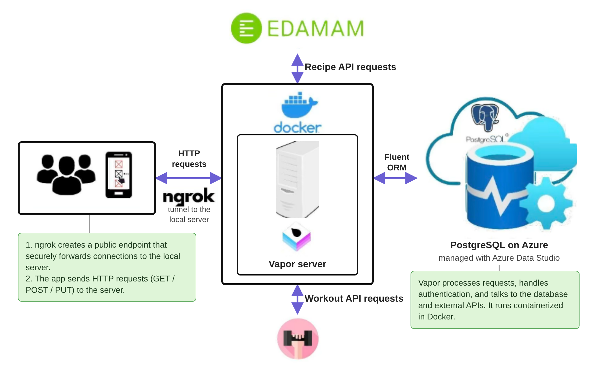

# Glowin: iOS app

**Glowin** is an iOS fitness app that tracks your body measurements and turns them into personalized goals, workout plans and recipes that fit your nutrition targets.

Built solo in **SwiftUI**. It talks to a Swift/Vapor server, which lives in [Glowin-Backend](https://github.com/ayaanmonappa/Glowin-Backend).



## At a glance

| | |
|---|---|
| Language | Swift + SwiftUI (~3,700 lines across 50 files) |
| UI | 31 SwiftUI views, MVVM structure with view models |
| Charts | Swift Charts for progress graphs |
| Networking | URLSession with async/await, token-authenticated requests |
| Background work | BackgroundTasks for recipe refreshes, local notifications |

## Features

- **Sign up and log in**, with live checks that a username or email isn't taken.
- **Onboarding** that captures age, fitness goal, activity level and body type (ectomorph, mesomorph or endomorph, with illustrations).
- **Body measurement tracking** for weight, height, chest, waist, bicep, thigh and calf, with illustrated guides showing exactly where to measure.
- **Progress charts** showing how each measurement changes over time.
- **Recommended goals** generated by the server from your measurements and calorie needs.
- **Workout plans:** choose how many days a week you train, and get a split matched to your goal, with sets, reps and exercise details.
- **Recipes** matched to your calorie and protein, fat and carb targets, in grid, list and detail views.
- **Background recipe fetching**, with a notification when new recipes are ready.

## Project structure

```
HealthApp/
├── Views/          main screens: onboarding, login, home, measurements, goals, charts
├── View Models/    state and logic for the measurement and stats screens
├── Models/         data types shared with the server
├── WWorkout/       workout plan generation and exercise screens
├── Recipe API/     recipe screens, service and background fetch
├── Utilities/      app entry point, HTTP client, constants, colours
└── Assets.xcassets icons, logo and measurement guide images
```

## Running it

1. Start the backend by following the steps in [Glowin-Backend](https://github.com/ayaanmonappa/Glowin-Backend#running-it-locally).
2. Run `ngrok http 8080` and paste the forwarding URL into `baseURL` in `HealthApp/Utilities/constants.swift`.
3. Open the project in Xcode and press Run to launch it in the simulator.
